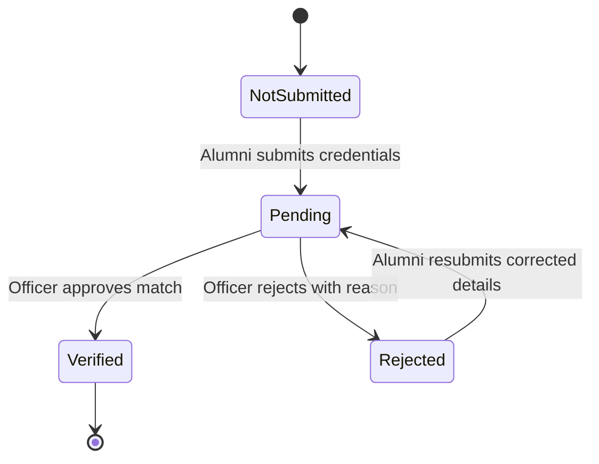

# P11 — Verified Alumni Mentorship Matching and Engagement Platform

## System Architecture and Engineering Documentation

---

## 1. Project Purpose and Vision

The **P11 Verified Alumni Mentorship Matching and Engagement Platform** is an institutional software solution created to bridge the gap between undergraduate students and verified university alumni. Unlike open commercial platforms or unstructured networking forums, P11 enforces institutional credential verification, transparent explainable mentor-mentee matching, structured engagement tracking (goals, action items, feedback), and strict privacy boundaries.

---

## 2. Technology Stack & Decision Rationale

| Layer                  | Technology                        | Selection Rationale                                                                       |
| :--------------------- | :-------------------------------- | :---------------------------------------------------------------------------------------- |
| **Monorepo Engine**    | npm workspaces                    | Native cross-platform workspace management without third-party monorepo lock-in.          |
| **Frontend Framework** | Next.js (App Router, React 19)    | Server-side rendering, SEO metadata, streaming UI, robust routing.                        |
| **Frontend Styling**   | Tailwind CSS v3 + CSS Variables   | High performance, zero runtime style injection, tokenized university theme.               |
| **UI Components**      | shadcn/ui design patterns         | Accessible, headless primitives styled with Tailwind, full ownership of code.             |
| **Backend Framework**  | Node.js + Express.js + TypeScript | High throughput, asynchronous I/O, clean middleware architecture.                         |
| **Database**           | MongoDB Atlas / MongoDB           | Document flexibility for alumni credentials, preference trees, and audit trails.          |
| **ODM**                | Mongoose                          | Strict schema validation, lifecycle middleware, strongly typed data models.               |
| **Validation**         | Zod                               | Single source of truth for runtime environment validation and request schema enforcement. |
| **Security Headers**   | Helmet                            | Enforces HTTP security headers (CSP, HSTS, X-Content-Type-Options, etc.).                 |
| **Logging**            | Pino + pino-http                  | High-performance structured JSON logging with automated PII redaction.                    |
| **Testing**            | Vitest + Supertest + RTL          | Fast native ESM test runner with jsdom and API integration capabilities.                  |

---

## 3. High-Level Architecture Diagram

```mermaid
graph TD
    subgraph Client ["Frontend: Next.js (Port 3000)"]
        UI[App Router & Tailwind UI]
        Forms[React Hook Form + Zod]
        State[Local / Auth State]
    end

    subgraph SecurityBoundary ["Security & Network Boundary"]
        CORS[CORS Policy & Helmet Headers]
        ReqId[X-Request-Id Correlation]
        Redact[Pino Redaction Filter]
    end

    subgraph Backend ["Backend: Express.js (Port 5000)"]
        App[Express Pipeline]
        Health[Health & Readiness Module]
        FutureAuth[Auth & RBAC Module (Phase 2)]
        FutureMatch[Explainable Matcher (Phase 4)]
        FutureModules[Alumni, Students, Scheduling Modules]
    end

    subgraph Storage ["Data Tier"]
        MongoAtlas[(MongoDB Atlas / Local DB)]
    end

    UI -->|HTTP / JSON / Credentials| CORS
    Forms -->|Validated Payloads| CORS
    CORS --> ReqId
    ReqId --> Redact
    Redact --> App
    App --> Health
    App --> FutureAuth
    App --> FutureMatch
    App --> FutureModules
    Health -->|State Probe| MongoAtlas
    FutureModules -->|Mongoose Queries| MongoAtlas
```

---

## 4. Monorepo Organization

```
p11-mentorship-platform/
├── client/                     # Next.js App Router frontend application
│   ├── public/                 # Static public assets
│   ├── src/
│   │   ├── app/                # Next.js pages & layouts (/, /login, /register)
│   │   ├── components/
│   │   │   ├── layout/         # Navbar, Footer, Container
│   │   │   └── ui/             # Button, Input, Label, Card, Badge, Alert, Spinner
│   │   ├── lib/                # Utility helpers (cn, formatters)
│   │   ├── test/               # Frontend smoke tests & setup
│   │   ├── hooks/              # Custom React hooks (future)
│   │   └── types/              # Client-side type definitions
│   ├── package.json
│   ├── tsconfig.json
│   └── tailwind.config.ts
│
├── server/                     # Express.js REST API backend application
│   ├── src/
│   │   ├── config/             # Environment, Database, Logger configuration
│   │   ├── middleware/         # Error handler, 404 handler, Request ID
│   │   ├── modules/            # Encapsulated feature domains
│   │   │   ├── health/         # Liveness & Readiness checks
│   │   │   └── README.md       # Specification for Phase 2+ domain modules
│   │   ├── app.ts              # Express application assembly & middleware
│   │   └── server.ts           # Database connection & HTTP listener entrypoint
│   ├── tests/                  # Supertest integration tests & redaction tests
│   ├── package.json
│   └── tsconfig.json
│
├── docs/
│   └── ARCHITECTURE.md         # Complete system architecture documentation
├── .env.example                # Configuration template with placeholders
├── .gitignore                  # Git exclusion rules
├── .nvmrc                      # Node.js LTS version specification
├── .prettierrc.json            # Code formatting conventions
├── package.json                # Root workspaces and orchestration scripts
└── README.md                   # Getting started and setup guide
```

---

## 5. Frontend / Backend Communication Strategy

1. **API Endpoints**: All backend endpoints are exposed under `/api/v1/*`.
2. **Transport**: JSON payloads over HTTP/HTTPS with strict `Content-Type: application/json` headers.
3. **CORS Protocol**:
   - `Access-Control-Allow-Origin` is explicitly restricted to `CLIENT_URL` (e.g., `http://localhost:3000`).
   - Wildcards (`*`) are disallowed.
   - `credentials: true` is enabled to support HTTP-only session cookies.
4. **Correlation Tracing**:
   - `requestIdMiddleware` assigns a UUIDv4 to incoming requests.
   - Returned in the response header `X-Request-Id` for debugging.

---

## 6. Authentication, Authorization & Security Architecture

### Authentication Model

- **Token Delivery**: JSON Web Tokens (JWT) stored exclusively in **HTTP-only, SameSite=Lax, Secure** cookies.
- **Client Storage Policy**: Tokens are **never** stored in `localStorage`, `sessionStorage`, or JavaScript memory variables.
- **Password Protection**: Passwords hashed using `bcryptjs` with salt work factor $\ge 10$.

### Five-Tier Role-Based Access Control (RBAC)

The platform defines five distinct institutional roles:

1. **Student**: Public registration permitted. Can build career profiles, request mentorship, track sessions and milestones.
2. **Alumni / Mentor**: Public registration permitted. Requires institutional verification by an officer before becoming searchable or active.
3. **Alumni Relations Officer**: Internal administrative role. Reviews graduation proof, reconciles university ERP/CSV records, approves mentor verifications.
4. **Placement Officer**: Read-only reporting access. Reviews participation statistics and aggregate engagement without modifying mentor profiles.
5. **Platform Administrator**: System configuration, role elevation, and audit inspection.

> [!IMPORTANT]
> Public self-registration is strictly restricted to **Student** and **Alumni** roles. Administrative or Officer privileges can only be provisioned by existing Administrators.

### Sensitive Data Protection & DTO Projection

- Alumni personal phone numbers and direct email addresses are classified as **Restricted PII**.
- Student-facing endpoints will **never** return raw Mongoose documents.
- Explicit DTO whitelists project only approved fields (Full Name, Graduation Year, Degree, Industry, Current Role, Bio, Availability Slots).
- Privileged access to contact details requires an active, accepted mentorship agreement.

---

## 7. Structured Logging & Privacy Redaction

Pino is configured with high-performance serialization and automated field masking:

1. **Redacted Targets**:
   - `req.headers.authorization`
   - `req.headers.cookie`
   - `password`, `*.password`
   - `email`, `*.email`
   - `phone`, `*.phone`
   - Database connection URIs (credentials masked via `sanitizeMongoUri`).
2. **Payload Protection**:
   - Request bodies are not logged in bulk.
   - Query strings are stripped of raw sensitive tokens.
3. **Environments**:
   - In `development`: Human-friendly formatted output via `pino-pretty`.
   - In `production`: High-efficiency structured JSON streams suitable for cloud ingest.
   - In `test`: Silenced to prevent cluttering test output.

---

## 8. Database Architecture & MongoDB Strategy

- **Primary Storage**: MongoDB Atlas cloud cluster.
- **Local Alternative**: Local MongoDB instance (`mongodb://127.0.0.1:27017/p11_mentorship`) supported out-of-the-box.
- **Lifecycle Management**:
  - `connectDatabase()` handles initial handshake, connection pooling, and auto-reconnect listeners.
  - Initial connection failure enters a graceful degraded mode so readiness probes accurately report `503 Service Unavailable`.
  - Application shutdown safely terminates Mongoose connection pool.

---

## 9. Testing Strategy

| Suite                   | Scope                                           | Framework            | Execution Command                     |
| :---------------------- | :---------------------------------------------- | :------------------- | :------------------------------------ |
| **Backend Integration** | Health, readiness, 404, safe error handling     | Vitest + Supertest   | `npm run test:run --workspace=server` |
| **Backend Security**    | Log redaction, URI sanitization                 | Vitest               | `npm run test:run --workspace=server` |
| **Frontend Smoke**      | Landing page rendering, UI elements, navigation | Vitest + RTL + jsdom | `npm run test:run --workspace=client` |
| **Type Integrity**      | Strict TypeScript check across entire monorepo  | tsc --noEmit         | `npm run typecheck`                   |

---

## 10. Implementation Status & Phase Roadmap

|    Phase    | Milestone                            | Scope / Components                                                                                  |    Status    |
| :---------: | :----------------------------------- | :-------------------------------------------------------------------------------------------------- | :----------: |
| **Phase 1** | **Project Foundation**               | Monorepo structure, Express API, Next.js UI, security headers, health check, logging, documentation | **COMPLETE** |
| **Phase 2** | **Authentication & RBAC**            | User model, JWT cookie sessions, bcrypt hashing, role authorization middleware, AuthContext         | **COMPLETE** |
| **Phase 3** | **Alumni Verification (M1)**         | CSV/ERP graduate matching, manual review officer dashboard, verification status                     | **COMPLETE** |
| **Phase 4** | **Profiles & Mentorship Offerings**  | Student academic/career profiles, verified alumni professional profiles, offerings & discovery      | **COMPLETE** |
| **Phase 5** | **Explainable Matching Engine (M4)** | Deterministic 6-criteria weighted scoring (no black-box AI), data coverage, evidence breakdown      | **COMPLETE** |
| **Phase 6** | **Mentorship Workflows (M5, M6)**    | Requests, acceptance/rejection, `.ics` calendar generation, session tracking                        |  _Planned_   |
| **Phase 7** | **Goals & Analytics (M7, M10)**      | Milestones, action items, feedback rubrics, Placement Officer reporting                             |  _Planned_   |

---

## 11. Phase 3 Architecture: Institutional Verification & Officer Workflow

### 11.1 Verification Lifecycle & State Machine

Verification status is decoupled from the `User` account status (`active`, `disabled`, `suspended`):

- `not_submitted`: Initial default for registered alumni.
- `pending`: Submission received with deterministic matching executed; awaiting officer review.
- `verified`: Approved by officer; locks official record claim and activates verified alumni features.
- `rejected`: Rejected by officer with mandatory reason; alumnus may correct details and resubmit.



### 11.2 Deterministic Matching Engine

Zero black-box AI or LLM heuristics. Match evaluation is transparent and reproducible:

1. Exact match on normalized primary key: `alumni_id` (`UPPERCASE`, trimmed).
2. Primary identity consistency: normalized `institutional_email` (`lowercase`, trimmed).
3. Cross-field consistency checks: `graduation_year` (exact integer), `programme`, `department`.
4. Claim status check: prevents duplicate claims on the same institutional record.
5. Matching outcomes: `matched`, `unmatched`, `conflict`. All outcomes require explicit officer review.

### 11.3 Two-Stage CSV Import Pipeline

1. **Preview (`/records/import/preview`)**: In-memory parsing via streaming `csv-parse`, strict lowercase header validation (`alumni_id,full_name,institutional_email,programme,department,graduation_year`), row formatting check, in-file duplicate detection, and non-mutating claim conflict detection against existing records.
2. **Confirm (`/records/import`)**: Idempotent bulk upsert via `bulkWrite` using `$set` on details and `$setOnInsert` for claim state (`isClaimed: false`), preserving existing claimed associations.

### 11.4 Append-Only Audit Trail

Every verification lifecycle event (`VERIFICATION_SUBMITTED`, `VERIFICATION_RESUBMITTED`, `VERIFICATION_APPROVED`, `VERIFICATION_REJECTED`, `RECORDS_IMPORTED`) writes an unalterable log in `AuditLog` capturing actor ID, actor role, entity ID, request ID, timestamp, and metadata.

---

## 12. Phase 4 Architecture: Profiles, Mentorship Offerings & Discovery

### 12.1 Student Profile Management

- **Model**: `StudentProfile` (`userId` unique index).
- **Academic & Career Fields**: Programme, department, graduation year, academic interests, technical/professional skills, career interests, career goals, mentorship topics, preferred mode (`online`, `in-person`, `hybrid`), and short bio.
- **Dynamic Completion Calculation**: Evaluated strictly on the backend across 4 categories (Academic identity: 30%, Skills & Interests: 30%, Goals & Bio: 20%, Mentorship Preferences: 20%). Returned dynamically with `GET /api/v1/profiles/me`.

### 12.2 Alumni Professional Profile Management

- **Model**: `AlumniProfile` (`userId` unique index).
- **Professional Identity**: Professional headline, current designation, company, industry domain, years of experience, bio, skills, areas of expertise, mentorship topics, preferred modes, draft state (`isDraft`), and public visibility (`isPubliclyVisible`).
- **Institutional Immutability**: Degree credentials (`alumniId`, `institutionalEmail`, `programme`, `department`, `graduationYear`) are projected as read-only from the approved `AlumniVerification` record. Alumni cannot modify official degree records.
- **Publishing Guard**: An alumnus cannot publish (`isDraft: false` or `isPubliclyVisible: true`) unless their `AlumniVerification.status === 'verified'` and `User.accountStatus === 'active'`.

### 12.3 Mentorship Offer Creation & Lifecycle

- **Model**: `MentorshipOffer` (compound discovery indexes: `status`, `isDeleted`, `alumniId`, `topics`, `mode`).
- **Offering Schema**: Title, description, topics, target audience, session mode (`online`, `in-person`, `hybrid`), duration (15–180 minutes), and monthly mentee capacity limit.
- **Lifecycle & Soft Deletion**: Offerings can transition between `active`, `paused`, and `closed`. Deletion is strictly soft (`isDeleted: true`), preserving historical auditability and preventing orphan references.
- **Alumni Ownership & Guard**: Only verified active alumni can create or modify offerings; ownership is verified prior to update or deletion.

### 12.4 Mentorship Discovery Engine

- **Endpoint**: `GET /api/v1/mentorship/offers` (available to all authenticated users).
- **Strict Discovery Criteria**: Offers must satisfy:
  1. `MentorshipOffer.isDeleted === false` and `MentorshipOffer.status === 'active'`.
  2. `AlumniProfile.isDraft === false` and `AlumniProfile.isPubliclyVisible === true`.
  3. `AlumniVerification.status === 'verified'`.
  4. `User.accountStatus === 'active'`.
- **Search & Filtering**: Keyword search across title, description, and topics with regex sanitization; filtering by topic, industry, and session mode; standard backend pagination (`page`, `limit`, `totalPages`, `totalCount`).

---

## 13. Phase 5 Architecture: Explainable Mentor–Student Matching Engine

### 13.1 Philosophy & Zero Black-Box Guarantee

The matching engine is entirely deterministic and mathematically transparent. It uses zero external NLP services, generative AI, embeddings, or vector databases. All calculations are executed synchronously on normalized database tokens, guaranteeing identical outputs for identical inputs regardless of request timing or order.

### 13.2 6-Criteria Weighted Scoring Model

Scoring is divided into six dimensions totaling 100%:

| Criterion                                   | Weight | Assessment Inputs                                                                | Scoring Logic                                                                |
| :------------------------------------------ | :----: | :------------------------------------------------------------------------------- | :--------------------------------------------------------------------------- |
| **1. Mentorship Topics & Career Interests** |  30%   | Student topics/interests vs. Offering topics + Mentor expertise                  | Set intersection ratio of normalized tokens ($                               | matched | /   | studentTopics | $)  |
| **2. Skills & Technical Expertise**         |  25%   | Student skills vs. Mentor skills + Areas of expertise                            | Set intersection ratio of normalized tokens                                  |
| **3. Career Goals & Industry Domain**       |  20%   | Student career goals text & interests vs. Mentor industry, headline, designation | Keyword extraction & token overlap; bonus for exact industry alignment       |
| **4. Mentorship Delivery Mode**             |  10%   | Student preferred mode vs. Offering delivery mode                                | Fixed compatibility matrix (Exact: 1.0, Hybrid partial: 0.75, Conflict: 0.0) |
| **5. Academic Department & Programme**      |  10%   | Student department/programme vs. Authoritative verified alumni records           | Exact programme & department: 1.0; Single field match: 0.5; None: 0.0        |
| **6. Language Compatibility**               |   5%   | Student preferred languages vs. Mentor supported languages                       | Set intersection overlap ratio                                               |

### 13.3 Dynamic Score Normalization & Data Coverage

1. **Dynamic Normalization Formula**:
   $$S = \frac{\sum_{i \in A} (w_i \times s_i)}{\sum_{i \in A} w_i} \times 100$$
   Where $A$ is the set of assessable criteria. Missing student preferences are never counted as successful matches and are excluded from the denominator.
2. **Data Coverage Percentage**:
   $$\text{Coverage} = \sum_{i \in A} w_i$$
   Reflects the proportion of criteria that could be evaluated.
3. **Minimum Evidence Threshold**:
   A configurable threshold (`MIN_DATA_COVERAGE_THRESHOLD = 40%`) flags recommendations as having insufficient profile data, returning guidance prompts to the student rather than false high-confidence scores.
4. **Recommendation Categories**:
   - $\ge 80\%$: `Strong Match`
   - $\ge 65\%$: `Good Match`
   - $\ge 50\%$: `Moderate Match`
   - $< 50\%$: `Limited Match`

### 13.4 Strict 4-Layer Backend Eligibility

Before scoring, all candidate offerings must pass a strict 4-layer validation query:

1. `MentorshipOffer`: `status === 'active'` and `isDeleted === false`.
2. `User` (mentor): `accountStatus === 'active'` and `role === 'alumni'`.
3. `AlumniVerification`: `status === 'verified'` (ensuring authoritative institutional identity).
4. `AlumniProfile`: `isDraft === false` and `isPubliclyVisible === true`.

### 13.5 Deterministic Ranking & Tie-Breaking

Ranked candidates are sorted using strict priority:

1. Compatibility score descending
2. Data coverage percentage descending
3. Topic alignment criterion score descending
4. Stable tie-breaker: `offerId` string comparison ascending
